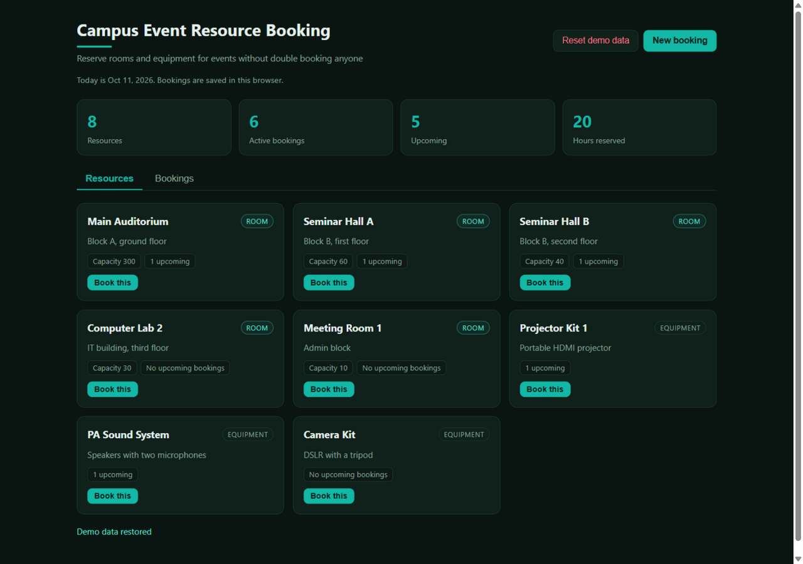
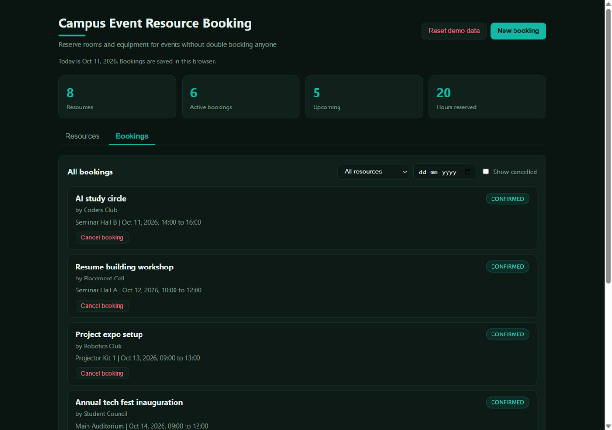

# Campus Event Resource Booking Platform

A straightforward booking system for campus rooms and equipment. Clubs and departments pick a resource, choose a date and time, and the platform refuses double bookings with a clear message showing exactly which event is in the way.

**Live demo:** [https://rajpalgelot-tech.github.io/Campus-Event-Resource-Booking-Platform/](https://rajpalgelot-tech.github.io/Campus-Event-Resource-Booking-Platform/)



Everything runs in the browser and bookings are stored in `localStorage`, so a refresh or a closed tab keeps your data and nothing is sent anywhere.

## Features

- Resource catalog with five rooms (auditorium, seminar halls, lab, meeting room) and three equipment kits, each with type, location, and capacity
- Booking form with event title, organizer, date, and start/end times
- Clash detection: overlapping bookings on the same resource and date are rejected, and the error names the conflicting event, resource, and time range
- Back to back bookings are allowed: a slot that starts exactly when another ends is not a clash (half open interval logic)
- Past guards: no bookings for past dates, and a start time earlier today is refused
- Cancel bookings with a two step confirm, which frees the slot for others immediately
- Booking list with resource and date filters, plus a show cancelled toggle
- Summary cards: resources, active bookings, upcoming count, and total hours reserved
- Sample data on first load so the app is never empty



## Tech stack

- TypeScript in strict mode, zero runtime dependencies
- Vite for the dev server and the production build
- Vitest for the test suite (38 deterministic tests)
- Plain DOM APIs, no framework

## How clash detection works

Times are converted to minutes since midnight, and each booking occupies the half open interval [start, end). Two intervals clash when each starts before the other ends:

```
overlaps = aStart < bEnd && bStart < aEnd
```

That single comparison gives the correct answers at the boundaries: 10:00 to 12:00 clashes with 11:00 to 12:30, but 10:00 to 12:00 and 12:00 to 13:00 only touch, so both can be booked.

Validation runs before the clash check: known resource, non empty title and organizer, a real date in YYYY-MM-DD format, valid HH:MM times, end after start, and the past date and past time guards. All date and time logic is pure and takes `today` and the current minute as arguments, so tests are deterministic.

## Project structure

```
src/
  booking/
    types.ts      Resource and Booking models
    dates.ts      UTC safe date helpers and local today/now helpers
    scheduler.ts  Time parsing, overlap test, conflict search, validation
    store.ts      BookingStore class, seeds, localStorage persistence, summary
  ui/
    app.ts        Tabs, resource grid, booking list, modal form, rendering
    styles.css    Dark theme with a teal accent
tests/
  scheduler.test.ts  Boundary cases: touching slots, other resources, cancelled bookings
  store.test.ts      Booking flows, cancel and rebook, ids, persistence, corrupt storage
```

## Run locally

```bash
npm install
npm run dev       # dev server
npm test          # run the test suite
npm run build     # production build into dist/
npm run preview   # serve the production build
```

## Deployment

Pushes to `main` run the CI workflow, which typechecks, tests, builds, and deploys the `dist/` folder to GitHub Pages through the official Pages actions.

## License

MIT, see [LICENSE](LICENSE).
